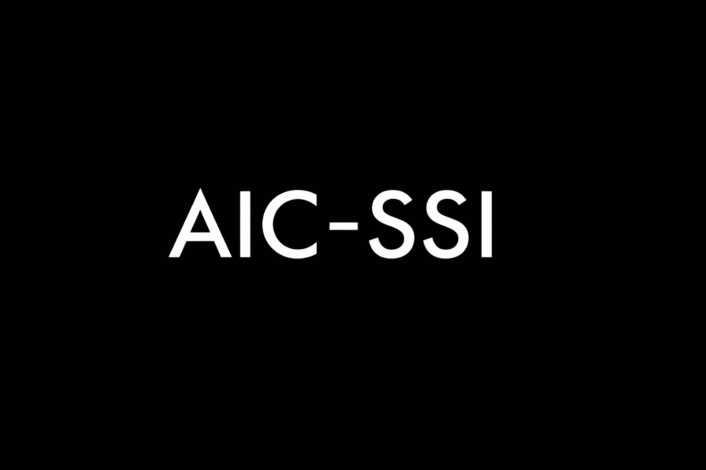

# AIC-SSI – Self-Sovereign Identity

**Official Self-Sovereign Identity Layer** of  
**Adaptive Intelligence Circle (AIC) & Human Meaning Network (HMN)**

<p align="center">
  
</p>

### Vision

A governance-oriented exploration of self-sovereign identity,
human agency, trust, and institutional resilience
for a world of increasingly distributed and cross-border systems.

This repository is not an identity provider. This repository is not a government identity system. This repository is not a production-ready implementation.

Its purpose is to explore how identity, governance, and human agency may coexist within public-interest digital infrastructure.

### Core Principles
- **Self-sovereignty**: Identity belongs to the individual/node, not to any third party.
- **Ethical-by-design**: All identity operations are governed by the ethical kernel (IBCS).
- **Zero-donation & non-profit**: No financial incentives or external funding.
- **Privacy-first & quantum-safe**: Built for long-term resilience in a post-scarcity world.
- **GPLv3.0 licensed**: Full transparency and copyleft protection.

### Structure 
``` pgsql
AIC-SSI/
├── README.md                          # Trang chính + tầm nhìn SSI trong AIC
├── LICENSE                            # GPLv3.0
├── CODE_OF_CONDUCT.md
├── CONTRIBUTING.md
├── SECURITY.md
├── GOVERNANCE.md
├── POLICIES/
│   ├── ETHICAL-IDENTITY-POLICY.md     # Chính sách danh tính đạo đức
│   ├── ZERO-DONATION-POLICY.md        # (link hoặc copy từ repo Legal)
│   └── THIRD-PATH-PRINCIPLES.md
├── src/                               # Code chính
│   ├── core/                          # SSI Core Engine
│   ├── did/                           # Decentralized Identifier
│   ├── vc/                            # Verifiable Credentials
│   ├── wallet/                        # Ethical Wallet
│   └── crypto/                        # Quantum-safe + ethical crypto
├── tests/                             # Unit & integration tests
├── scripts/                           # Tools hỗ trợ
├── docs/                              # Tài liệu kỹ thuật
│   ├── architecture.md
│   └── integration-guide.md
├── examples/                          # Ví dụ sử dụng
├── ANNOUNCEMENTS/                     # Lưu thông báo
│   └── YYYY-MM-Status.md
├── HISTORY/
│   └── CHANGELOG.md
└── CONTACT.md 
``` 

### Key Features (in development)
- Decentralized Identifiers (DID)
- Verifiable Credentials (VC)
- Ethical Wallet & key management
- Integration with AIC-DePin and AIC-EdgeOS
- Quantum-resistant cryptographic primitives
- Recovery & resilience mechanisms for HMN

### Current Status (April 2026)
This repository is in early architecture and prototype stage.  
It will serve as one of the foundational layers to protect user/node autonomy during and after the Founder’s mandatory military service.

**Part of the larger AIC ecosystem**:  
[Adaptive Intelligence Circle](https://github.com/AdaptiveIntelligenceCircle)

**License**: GPLv3.0 with Ethical Use Addendum (see `/POLICIES`)

**Maintained by**: Nguyễn Đức Trí (Founder & Architect)